  

<h1 align="center">Ethan Yucetepe</h1>

  Backend systems and developer tooling. CS at NJIT, graduating <b>December 2026</b>.

  <b>Experience</b>&nbsp;&nbsp;
  Technology Intern at Thryv (May to August 2026)
  &nbsp;/&nbsp; Co-Founder, <a href="https://scrappyai.app">Scrappy AI</a>
  &nbsp;/&nbsp; Founder, <a href="https://goneidle.com">goneIdle</a>
   
  <b>Shipped</b>&nbsp;&nbsp;
  <a href="https://store.steampowered.com/app/4544780">TideWane</a> on Steam
  &nbsp;/&nbsp; <a href="https://apps.apple.com/app/id6781905536">Scrappy AI</a> on the App Store
  &nbsp;/&nbsp; <a href="https://github.com/EthanY33/atelier">atelier</a>, listed in <a href="https://github.com/hesreallyhim/awesome-claude-code">awesome-claude-code</a>

  <a href="https://ethanyucetepe.dev">ethanyucetepe.dev</a>
  &nbsp;/&nbsp;
  <a href="https://www.linkedin.com/in/ethan-yucetepe/">LinkedIn</a>
  &nbsp;/&nbsp;
  <a href="mailto:ethanyucetepe@gmail.com">ethanyucetepe@gmail.com</a>
   
  Open to new-grad software engineering roles starting in early 2027.

