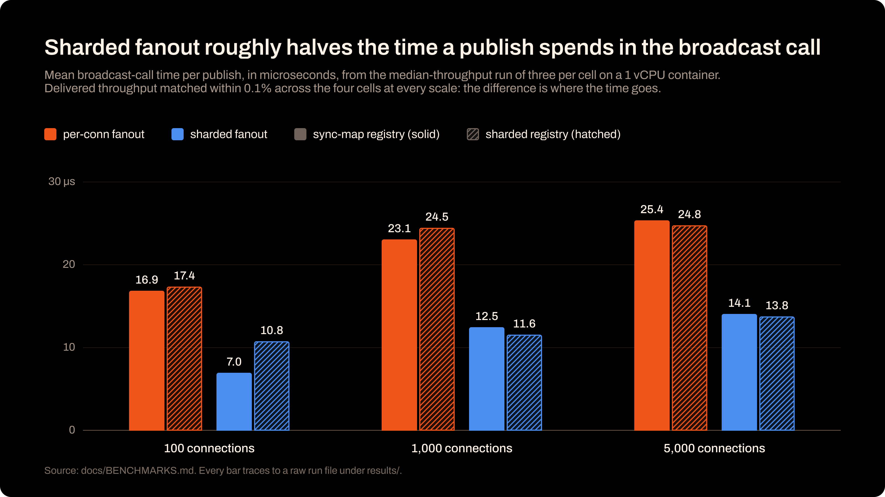
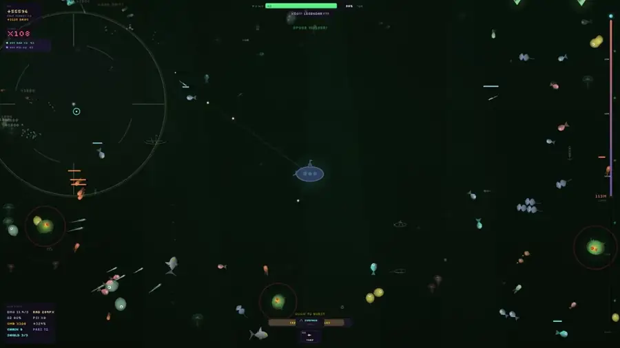
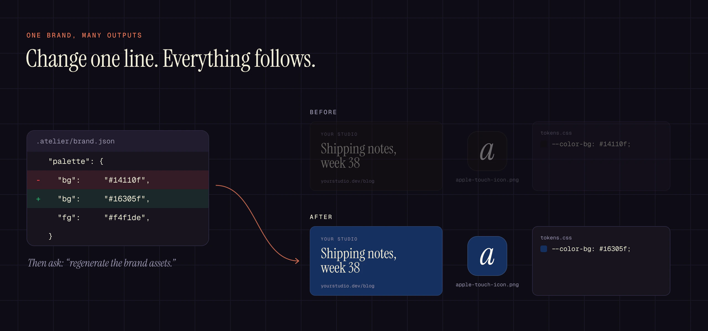

  

<h1 align="center">Ethan Yucetepe</h1>

  CS at NJIT, graduating <b>December 2026</b>. I build backend systems and developer tooling, and I have shipped two products: my own game on Steam and a co-founded iOS app on the App Store.

  <a href="https://ethanyucetepe.dev">ethanyucetepe.dev</a>
  &nbsp;/&nbsp;
  <a href="https://www.linkedin.com/in/ethan-yucetepe/">LinkedIn</a>
  &nbsp;/&nbsp;
  <a href="mailto:ethanyucetepe@gmail.com">ethanyucetepe@gmail.com</a>

  Open to new-grad software engineering roles starting in early 2027.

## Experience

- **Thryv**, Technology Intern, May to August 2026. Shipped a p95 < 300 ms latency gate for a Java 21 / Micronaut webhooks microservice. After each merge to main, CircleCI load-tested all 6 endpoints with k6 on a locally booted instance. Merged fixes for 7 security findings across 3 repos.
- **[Scrappy AI](https://scrappyai.app)**, Co-Founder, May 2026 to present. Co-launched a Swift 6 / SwiftUI iOS app that turns a fridge photo into ranked recipes, [live on the App Store](https://apps.apple.com/app/id6781905536) since August 2026. Wrote 186 of its 320 commits and grew the iOS suite from 784 to 1,169 tests.
- **[goneIdle](https://goneidle.com)**, Founder and Developer, March 2026 to present. Shipped [TideWane](#tidewane), a paid game on Steam, then released 8 patches in 5 weeks with public patch notes.
- **TemplateBreaker** (writing-analysis web app), June 2026 to present. Cut the AI-writing detector's false hard fails on 407 pre-2023 human blog posts from 177 (43%) to 18. Implemented concurrency-safe LLM spend caps in PL/pgSQL with advisory locks.

## Featured work

### [wirefan](https://github.com/EthanY33/wirefan)

Single-binary WebSocket pub/sub server in Go. [Live demo](https://wirefan.ethanyucetepe.dev), [benchmarks](https://github.com/EthanY33/wirefan/blob/main/docs/BENCHMARKS.md).

  

- **23,568 delivered msg/s** at 500 connections with the server container limited to 1 CPU, at a client p99 of 6.68 ms. Separate runs held 5,000 concurrent connections. Every number traces to a raw run file in the repo.
- Private channels use HMAC-SHA256 subscribe tokens bound to one connection and one channel, with a five-minute expiry and replay protection.
- The test suite checks for leaked goroutines after 1,000 connections connect and disconnect, and CI runs it under the race detector.
- Prometheus metrics and pprof on a loopback admin listener, graceful drain and checksum-verified upgrades that roll back on a failed health check.

### [TideWane](https://store.steampowered.com/app/4544780)

Deep-sea idle dungeon crawler, sold on [Steam](https://store.steampowered.com/app/4544780) for Windows, macOS and Linux. I am its only developer, as [goneIdle](https://goneidle.com/tidewane): game client, economy, audio, store page and site.

  

- React 18 game client embedded in a Godot 4 / C# host over a 10-type IPC protocol that carries saves and Steam achievements.
- Canvas 2D game loop, procedural Web Audio synthesis, a 3-layer prestige economy and 25 bosses.
- Opt-out telemetry on Cloudflare Workers and D1 that stores no Steam ID or IP and deletes on request, covered by 52 tests.
- Root-caused 2 silent production bugs, including an ID mismatch that had kept every player's achievements off Steam.

### [atelier](https://github.com/EthanY33/atelier)

Claude Code plugin for design automation. One `brand.json` drives eight skills, including design tokens, social cards, icons, responsive images, HTML-to-video, an accessibility audit and a 65-rule runtime UX audit.

  

- Listed in [awesome-claude-code](https://github.com/hesreallyhim/awesome-claude-code) (55K stars) under Design and UI/UX.
- Ships as a plugin, a CLI and a GitHub Action. 1,205 tests pass in CI on Ubuntu, macOS and Windows.
- Its HTML-to-video recorder runs on a virtual clock that steps timers, requestAnimationFrame, CSS and SVG animations to each frame time.

## More projects

- **[jobcopilot](https://github.com/EthanY33/jobcopilot)**: job-application copilot. Four Claude API routes parse a PDF resume and a job-posting URL, then draft cover letters and resume bullets, with prompt caching on the drafting calls. Next.js, Supabase, Prisma.
- **[leftoff](https://github.com/EthanY33/leftoff)**: Claude Code plugin. `/leftoff` saves a session log, and the next session starts with it.
- **[trailer-tripwire](https://github.com/EthanY33/trailer-tripwire)**, **[copy-tripwire](https://github.com/EthanY33/copy-tripwire)**, **[screenshot-tripwire](https://github.com/EthanY33/screenshot-tripwire)**: three Node.js audit CLIs that also run as Git hooks. They block fade-heavy trailers, AI-cliche copy and off-spec Steam images.
- **[PrivacyPulse](https://github.com/EthanY33/PrivacyPulse)**: Chrome extension that intercepts cookie consent banners and shows what you are agreeing to before you click Accept All.
- **[news-bias-analyzer](https://github.com/EthanY33/news-bias-analyzer)**: CS485 coursework. Python CLI that compares how several outlets frame the same story, using Gemini.

## Stack

**Languages:** TypeScript, JavaScript, Java, Go, Swift, Python, SQL 
**Frameworks and data:** Node.js, React, Next.js, SwiftUI, Godot 4 (C#), PostgreSQL, Supabase 
**Infrastructure:** Docker, GitHub Actions, CircleCI, Terraform
